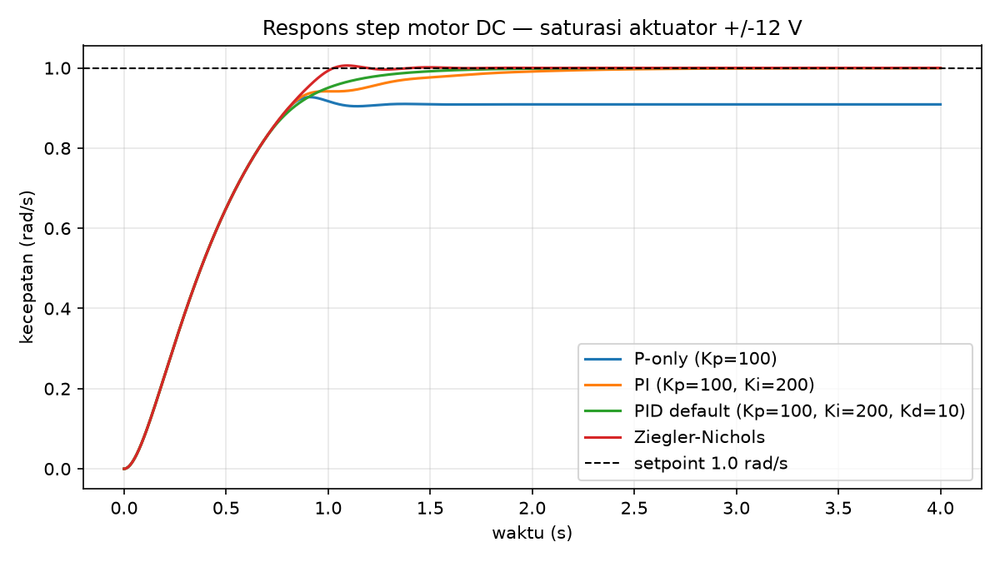
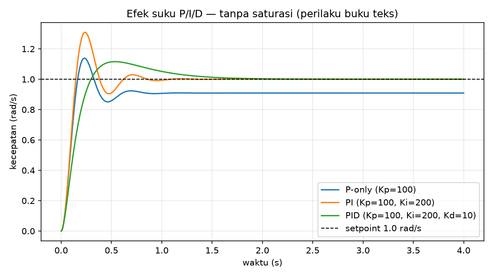

# pid-controller-sim

Simulasi PID kecepatan motor DC dalam C++17 — model plant orde-2
standar, kontroler PID digital (turunan pada pengukuran + anti-windup),
tuning Ziegler–Nichols dari identifikasi kurva reaksi, metrik respons
step, ekspor CSV, dan plot ASCII.

## Background

Motor DC magnet permanen yang dikontrol jangkarnya dimodelkan oleh dua
persamaan (CTMS, University of Michigan):

    L·di/dt = V − R·i − Ke·ω
    J·dω/dt = Kt·i − B·ω

Parameter default adalah contoh motor CTMS — diturunkan dari pengukuran
motor nyata di lab kontrol sarjana Carnegie Mellon:

| Parameter | Nilai |
| --- | --- |
| J (inersia rotor) | 0,01 kg·m² |
| B (gesekan viscous) | 0,1 N·m·s/rad |
| Ke = Kt | 0,01 (V·s/rad = N·m/A) |
| R | 1 Ω |
| L | 0,5 H |

Konsekuensinya: gain DC plant hanya 0,0999 rad/s per volt — motor butuh
~10 V untuk mencapai 1 rad/s. Aktuator default dijenuhkan di ±12 V,
seperti catu daya kecil pada umumnya.

Kontrolernya PID bentuk paralel `u = Kp·e + Ki·∫e + Kd·de/dt` dengan
dua fitur implementasi digital: turunan pada pengukuran (tanpa
*derivative kick*) dan anti-windup *conditional integration*.
Auto-tune memakai metode kurva reaksi Ziegler–Nichols (1942): metode
*ultimate gain* dan relay-feedback Åström–Hägglund (1984) sengaja
tidak dipakai — plant dua-kutub-real ini tidak bisa dibuat berosilasi
oleh kontrol P-only (beda fase tidak pernah mencapai −180°), jadi
tidak ada Ku/Pu yang bisa diukur. Penjelasan lengkap + validasi silang
terhadap model kontinu (SciPy) ada di [`docs/RESEARCH.md`](docs/RESEARCH.md).

## Project structure

```
pid-controller-sim/
├── Makefile                    # make / make test / make examples
├── LICENSE                     # MIT
├── README.md
├── .gitignore
├── src/
│   ├── motor.h / motor.cpp     # model motor DC (RK4)
│   ├── pid.h / pid.cpp         # kontroler PID + anti-windup
│   ├── metrics.h / metrics.cpp # overshoot, rise, settling, ess, IAE
│   ├── tuning.h / tuning.cpp   # identifikasi kurva reaksi + Z-N
│   └── main.cpp                # CLI
├── tests/
│   └── test_pid.cpp            # 37 tes (tanpa framework eksternal)
├── examples/
│   ├── run_examples.sh         # menjalankan semua contoh
│   ├── plot_examples.py        # plot perbandingan (matplotlib)
│   ├── comparison.png          # P-only / PI / PID / Z-N (±12 V)
│   ├── nosat_comparison.png    # efek P/I/D tanpa saturasi
│   ├── *.csv                   # deret waktu tiap contoh
│   └── *_output.txt            # output CLI asli tiap contoh
└── docs/
    └── RESEARCH.md             # teori, tuning, validasi, referensi
```

## Build & test

```bash
make          # bangun ./pid-sim
make test     # bangun + jalankan 37 tes
make examples # bangun + jalankan semua contoh ke examples/
```

Hanya butuh `g++` (C++17, diuji dengan g++ 13.3) dan `make`.
Tidak ada dependensi runtime; `matplotlib` hanya untuk
`examples/plot_examples.py` (opsional).

## Usage

```bash
./pid-sim                                   # preset default (CTMS)
./pid-sim --preset zn --csv out.csv         # auto-tune Ziegler-Nichols
./pid-sim --kp 100 --ki 0 --kd 0            # P-only
./pid-sim --setpoint 5                      # uji saturasi aktuator
./pid-sim --identify                        # hanya identifikasi plant
./pid-sim --help                            # semua opsi
```

Opsi: `--kp/--ki/--kd`, `--preset default|zn|zn-pi|p-only|pi`,
`--setpoint` (rad/s, default 1), `--duration` (s, default 4),
`--dt` (s, default 0,001), `--vmax` (V, default 12; 0 = tanpa batas),
`--deriv-on-error`, `--csv FILE`, `--plot`, `--identify`.

## Example output

Preset default (Kp=100, Ki=200, Kd=10 — gain referensi CTMS),
setpoint 1 rad/s, saturasi ±12 V — output asli
[`examples/default_output.txt`](examples/default_output.txt):

```
PID motor DC — Kp=100.00 Ki=200.00 Kd=10.00 | setpoint=1.000 rad/s | durasi=4.00 s dt=0.0010 s | vmax=12.0 V | turunan pada pengukuran
Step-response metrics (setpoint 1.000 rad/s, durasi 4.00 s)
  Overshoot          :    0.00 %
  Rise time (10-90%) :   0.713 s
  Settling time (2%)  :   1.243 s
  Steady-state error :  0.0000 rad/s (0.00 %)
  Nilai akhir        :  1.0000 rad/s (puncak 1.0000 rad/s @ 4.000 s)
  IAE                :  0.4381 rad.s
  |V| maks           :   12.00 V (jenuh 16.5 % sampel)
```

Kriteria desain CTMS (settling < 2 s, overshoot < 5%, ess < 1%)
terpenuhi oleh preset default dengan saturasi realistis.



### Efek tiap suku P/I/D

Setpoint 1 rad/s, saturasi ±12 V:

| Preset | Overshoot | Rise time | Settling (2%) | ess |
| --- | --- | --- | --- | --- |
| P-only (Kp=100) | 0% | 0,694 s | tidak menetap* | 9,10% |
| PI (Kp=100, Ki=200) | 0% | 0,693 s | 1,601 s | 0,02% |
| PID default (100/200/10) | 0% | 0,713 s | 1,243 s | 0,00% |
| Ziegler–Nichols | 0,59% | 0,692 s | 0,962 s | 0,00% |

\* P-only tidak pernah masuk pita 2% karena ess-nya 9,1% > 2%.

Tanpa saturasi (`--vmax 0`) perilaku buku teks muncul murni — I
menambah overshoot, D meredamnya:

| Preset (tanpa saturasi) | Overshoot | Settling (2%) |
| --- | --- | --- |
| P-only | 13,87% | tidak menetap* |
| PI | 30,91% | 0,775 s |
| PID | 11,59% | 1,348 s |



### Auto-tune Ziegler–Nichols

`./pid-sim --preset zn` mengidentifikasi plant dulu dari step
open-loop 5 V, lalu memakai gain hasil identifikasi (output asli di
[`examples/zn_output.txt`](examples/zn_output.txt)):

```
Identifikasi kurva reaksi (step open-loop 5 V, 5 s):
  Gain DC K = 0.0999 rad/s per V
  Lag semu L = 0.0535 s, konstanta waktu T = 0.7470 s
  Titik belok @ 0.2010 s
  Z-N PID: Kp=167.74 Ki=1567.88 Kd=4.49
```

Z-N memang agresif (dirancang untuk *quarter-decay*): tanpa saturasi
overshoot-nya 57,54%; dengan saturasi ±12 V ia justru paling cepat
menetap (0,962 s) dengan overshoot hanya 0,59%.

### Kasus batas

| Kasus | Hasil (run asli) |
| --- | --- |
| `--kp 0 --ki 0 --kd 0` | Motor diam, ess 100%, IAE 4,0000 rad·s |
| `--setpoint 5` | Aktuator jenuh 100% sampel di 12 V; tercapai 1,198 rad/s dari 5 rad/s (ess 76,04%); integrator tetap terbatas berkat anti-windup |
| `--setpoint -1` | Simetris dengan +1: ess 0, settling 1,243 s |

## Tests

```bash
make test
# 37 passed, 0 failed
```

Tes memakai nilai harapan dari teori (bukan dari output program),
mis. kecepatan tunak open-loop 1 V = 0,0999001 rad/s, ess P-only
Kp=100 = 0,0910 rad/s, arus tunak 0,999 A; plus deret sintetis
hitung-tangan untuk metrik (overshoot 20%, rise 0,40 s, settling
0,69 s), tes anti-windup, tes saturasi, dan tes identifikasi Z-N.
Validasi silang terhadap model fungsi-alih kontinu (SciPy): ess
P-only cocok persis (0,0910 rad/s) dan puncak P-only tanpa saturasi
cocok dalam 0,3% (1,1387 vs 1,1355 rad/s).

## Design decisions

- **RK4, dt = 1 ms** untuk integrasi plant — cukup kecil terhadap
  konstanta waktu tercepat plant (τ2 = 0,1 s) sehingga error
  diskretisasi < 0,5% pada besaran yang divalidasi.
- **Turunan pada pengukuran (default)** — menghilangkan *derivative
  kick* saat setpoint melompat; untuk setpoint konstan hasilnya
  identik dengan turunan pada error. Opsi `--deriv-on-error`
  mengembalikan bentuk buku teks.
- **Anti-windup conditional integration** — integrator dibekukan saat
  jenuh dan error mendorong ke arah jenuh; tanpa ini, kasus setpoint
  5 rad/s membuat integral membesar tanpa batas.
- **Metode kurva reaksi untuk Z-N**, bukan *ultimate gain*/relay —
  plant dua-kutub-real ini tidak punya Ku/Pu (lihat
  [`docs/RESEARCH.md`](docs/RESEARCH.md) §3).
- **Tanpa framework tes eksternal** — runner assert sederhana agar
  proyek bisa dibangun di mana saja hanya dengan g++.
- **Bahasa C++** mengikuti rotasi bahasa antrean proyek harian
  (bukan Python), dan struktur modul inti/CLI dipisah agar
  `motor`/`pid`/`metrics`/`tuning` bisa dipakai ulang tanpa CLI.

## Limitations

- Model plant linear dan ideal: tanpa gesekan Coulomb, tanpa
  dead-zone, tanpa backlash, tanpa derau pengukuran, dan tanpa
  gangguan beban (torsi beban eksternal belum dimodelkan).
- Parameter motor tunggal (contoh CTMS); motor lain harus diganti
  lewat kode (belum ada opsi CLI `--motor`).
- Turunan dihitung dari beda hingga pengukuran — pada data berderau
  nyata, suku D membutuhkan filter low-pass (belum ada).
- Z-N kurva reaksi memberi gain agresif; tanpa saturasi overshoot
  57,54% — selalu cek metrik sebelum memakai gain hasil auto-tune.
- Overshoot 11,59% versi tanpa saturasi berbeda dari plot kontinu
  CTMS/MATLAB (1,03%) karena versi kontinu memakai *derivative kick*
  yang tidak dapat direalisasikan driver nyata; dijelaskan lengkap
  di `docs/RESEARCH.md` §6.

## References

1. Ziegler, J. G. & Nichols, N. B. (1942). Optimum settings for
   automatic controllers. *Transactions of the ASME*, 64, 759–768.
   doi:10.1115/1.2899060
2. Åström, K. J. & Hägglund, T. (1984). Automatic tuning of simple
   regulators with specifications on phase and amplitude margins.
   *Automatica*, 20(5), 645–651. doi:10.1016/0005-1098(84)90014-1
3. Åström, K. J. & Hägglund, T. (1995). *PID Controllers: Theory,
   Design, and Tuning*. 2nd ed., Instrument Society of America.
4. CTMS, University of Michigan. "DC Motor Speed: System Modeling" —
   https://ctms.engin.umich.edu/CTMS/index.php?example=MotorSpeed&section=SystemModeling
5. CTMS. "Motor Speed: PID Controller Design" —
   https://ctms.engin.umich.edu/CTMS/index.php?example=MotorSpeed&section=ControlPID
6. Hang, C. C., Åström, K. J. & Wang, Q. G. (2002). Relay feedback
   auto-tuning of process controllers — a tutorial review. *Journal
   of Process Control*, 12(1), 143–162.

## License

MIT — see [LICENSE](LICENSE).
